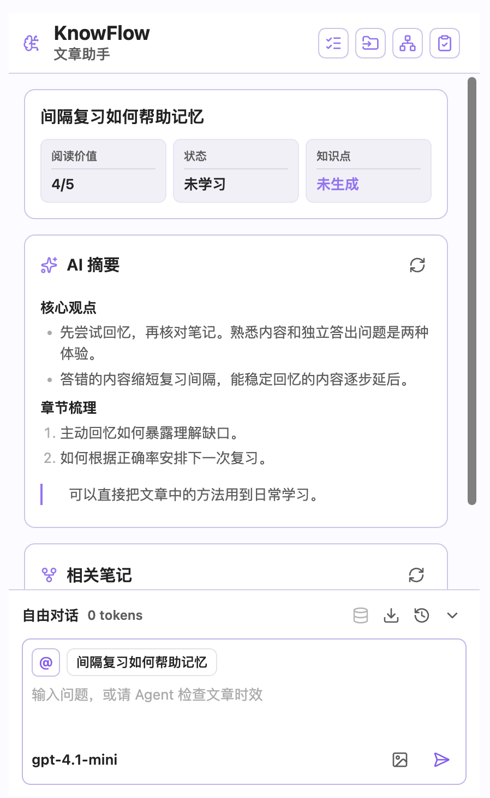
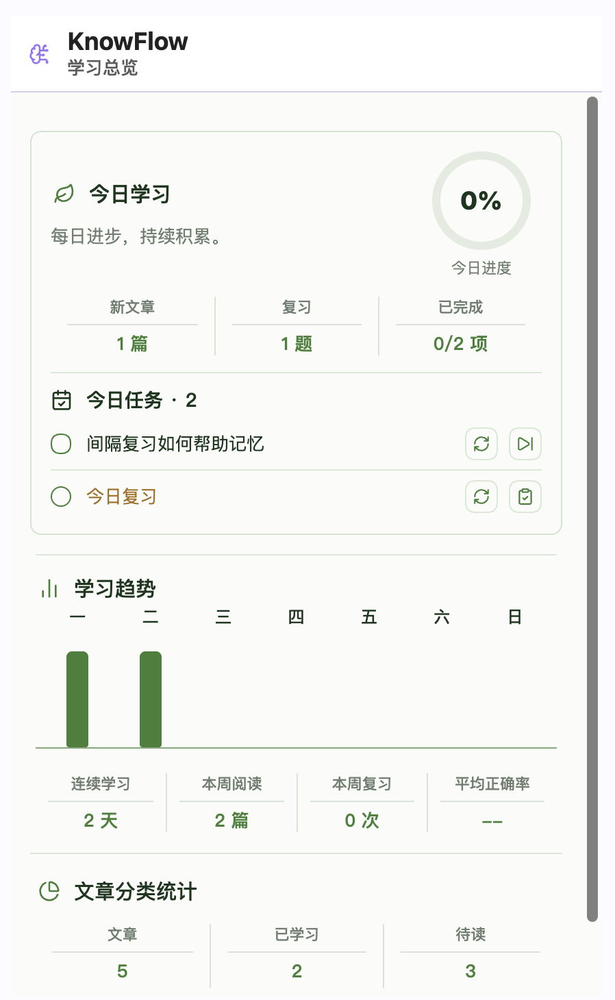

# KnowFlow

[中文](README.md) | English

> Turn notes into knowledge.

KnowFlow is an AI-powered Obsidian learning assistant. It turns web clippings and articles in your vault into knowledge you can organize, study, test, and review.

It is built around a complete learning loop, not a one-off summary:

```text
Clipping → Organize → Summary → Knowledge points → Quiz → Learning status → Daily review
```

## Screenshots

| Article study | Study overview |
| --- | --- |
|  |  |

## Current status

KnowFlow requires Obsidian 1.11.5 or later. Installation files are available on [GitHub Releases](https://github.com/phoenine/obsidian-knowflow/releases).

Available now:

- Organize the current Markdown clipping and repair common formatting problems.
- Fill in frontmatter, detect code blocks, and handle article categories.
- During organize, decide by paragraph: skip a fully Chinese paragraph, and translate a fully non-Chinese paragraph into Simplified Chinese. Code, formulas, standalone links, metadata, and existing generated content are left alone.
- Generate an AI summary, a reading value, and a suggested article category.
- Generate grouped knowledge points with evidence from the source.
- Generate, save, and answer a Markdown quiz.
- Record learning status and show Task Overview.
- Build a daily review from the global quiz bank.
- Chat with the current article, and save a conversation when you choose to. Answers start from the notes and add a clearly marked inference only when needed. Examples and analogies appear only when they help. Public sources are searched only when the notes lack a professional fact that can change. The sidebar shows “Chat with this article” by default; open it to type. Collapsing keeps the draft and the conversation, and the bottom bar shows whether a reply in progress has finished.
- Find Relevant Notes with a separate embedding model, and offer Vault Search in Chat as a switch.
- Run organize, summary, translation, knowledge points, quiz, and freshness checks through named skills. Article chat uses the plugin’s own conversation prompt.
- Search public sources, then check and update time-sensitive facts in an article.
- Filter related articles by title terms and the semantic index.

Not available yet:

- Auto organize
- Auto generate summary
- Auto generate quiz

Those three automations are not in Settings yet. They are planned for a later 2.0 release. Switch the interface language in Settings → Basic. The default is Simplified Chinese. Model replies and note fields do not follow the interface language.

## What it does

### Clipping Pipeline

KnowFlow can process the open Markdown clipping and keep the original structure with small edits:

- Remove ads, footers, and copy watermarks from web clippings.
- Repair heading levels, false headings, lists, tables, quotes, and code fences.
- Detect labels such as “提示词” and “提示词节选”, keep copyable prompts in `` `text` `` fences, and report how many were handled. Old text fences in prompt positions are converted to the same format.
- Before writing, check YAML, fences, prompt coverage, and whether media targets are still present. Existing tables and local-media doubts are reported with the result.
- Protect existing wikilinks, embeds, callouts, and code, math, and comment fences.
- Fill in frontmatter from the article template.
- Keep AI-generated content out of later AI input, so old results are not repeated or anchored.
- Organize writes back immediately. Moving into a built-in category creates that folder when it is missing.

### Learning materials

For an article worth studying, KnowFlow can also generate:

- An AI summary
- A reading value and a category suggestion
- Grouped knowledge points with evidence from the source
- A multiple-choice quiz with explanations

Quizzes are saved as Markdown files in `Archives/`, not appended to a growing plugin data file. Knowledge points and quizzes keep an index back to the source.

### Article maintenance

`clipping-update` restores headings, paragraphs, lists, comparisons, and copyable examples that may have been flattened during clipping. It preserves the original meaning and prepares the organized body for the AI summary.

- **Built-in skills.** Rules live in the project [skills directory](skills/README.md) and are packaged with the plugin. The plugin first fixes structure it can determine, then asks the model to review heading levels across the article. Code candidates go in separate batches of at most four. The plugin validates and writes the edits. A vault `skills/<name>/SKILL.md` replaces the built-in rule of the same name. `clipping-update` appends a vault rule, or the older `clipping-repair`, after the built-in rules.
- **Article summary.** Short notes use the cleaned full text. Long notes are sampled locally by section. The card streams the article's main takeaways and adds a section outline when mechanisms, methods, or evidence warrant a closer look. If the stream fails before content arrives or returns no usable summary, KnowFlow sends the same input in one non-streaming request. Saving preserves body edits made during generation.
- **Edit from chat.** In the open article’s chat, say what to change, for example “把开头那段改短”. The chat shows each insert, replacement, or deletion, then writes only after “更新” or a button. One confirmation can apply some of the items; the rest stay and are renumbered. An item is skipped when its passage is missing, appears more than once, overlaps another change, or the paragraph around an insert has changed. Ordinary questions stay in the chat.
- **Freshness check.** With an article open, type “检查当前文章是否过时” in the KnowFlow chat. The Chat model reads the full note by section, checks existing claims with [DeepSeek Search](https://api-docs.deepseek.com/guides/search/), and looks for missing developments that would change the reader’s understanding. The report lists only items that can be updated, then asks whether to change the note. Reply “更新” or “update” to write every item into its section. Added text is marked with `> [!note]`. Reply “应用第 2 条” or “apply 2” to write only that item. Reply “不用” or “no” to leave the note unchanged. “检查并更新” also lists suggestions first and writes only after you confirm. DeepSeek Search can reuse a configured official API key, or use its own key from `Settings → AI Models → DeepSeek Search → Configure`. Search, and page fetches when they are required, are billed by the API.
- **Related articles.** Relevant Notes drops weak semantic matches, then merges matches on specific title terms, and shows at most five notes. Shared tags only affect ranking. Each row shows a clickable title, an Add to Chat button, and up to two lines of the brief description.

### Task Overview

Task Overview collects the day’s learning progress:

- Pick the day’s new-article tasks.
- Show at most 4 items, and fold the rest.
- Show the global “Today’s review” entry.
- Summarize this week’s learning and review trend.
- Show article category stats, with 4 categories visible and the rest folded.

New-article tasks follow the current Task Overview scope. The daily review bank is always global and is not limited by the current article category.

### Daily review

Only articles that have been studied and have a valid quiz enter the review bank.

- A newly studied article enters the bank the next day.
- Question priority is: wrong → unanswered → correct questions that are due.
- Correct questions cool down for 7 days.
- The daily cap is 10 questions. Change it under Settings → Basic → Learning.
- The actual count is calculated from the questions that are currently eligible. Questions that are not due are not used to fill the quota.
- Each article has a soft cap of 2 questions. Question priority outranks spreading questions across articles.
- Starting a quiz locks that day’s paper. Refreshing does not replace questions already started.
- Answers are written back to the original quiz. Explanations can jump to the source, and to the section when that information exists.

## Suggested vault layout

The defaults match this layout:

```text
Vault/
├── Clippings/                 # New articles from Obsidian Web Clipper
├── Articles/                  # Long-term library, with optional category folders
├── Archives/                  # One Markdown quiz per article
├── copilot-conversations/     # Chat conversations you save yourself
└── Template/
    └── article.md              # Frontmatter field reference
```

Every path can be changed on the Basic tab of KnowFlow Settings.

## AI models

The summary model is configured on its own. Knowledge points, organize, and quiz share the Task model. Chat and freshness checks share the Chat model. The Embedding model is separate. The setting is named Task model. Supported runtimes:

- OpenAI-compatible Cloud API
- Ollama
- LM Studio
- Disabled

Each model has its own Runtime, Base URL, API Key, and Model ID.

Relevant Notes and Vault Search share a local semantic index. Configure the Embedding model under `AI Models`, then set `Excluded folders` under `Data` and build the index. The index covers only the articles folder (default `Articles/`) and excludes `assets` folders at any depth. It uses a small manifest and 128 stable hash shards. Chunk metadata and Float32 vectors are stored separately. A shard can resume after an interruption, and a damaged shard stays isolated. Each article indexes only an existing AI summary. Articles without a summary get no vector. Vault Search reads source passages after a hit. An older full-text index must be rebuilt after upgrading. With a Cloud runtime, AI summaries are sent to the configured embedding service while the index is built. See [Relevant Notes and Vault Search](docs/relevant-notes-and-vault-search.md).

### Network access, data, and costs

- **Model services.** Organizing, translation, summaries, knowledge points, and quizzes send article text or relevant excerpts to your configured model endpoint. Chat sends your question, conversation history, the current article, and any attached note context. When you enable Vault Search, Chat can also send matching passages from other notes. Cloud requests go to your chosen provider. Ollama and LM Studio connect to the local device by default.
- **Semantic search.** Building or updating the index sends article summaries to your configured embedding endpoint. Vault Search also sends the search query to that endpoint. The vector index stays in your vault.
- **Public search and image repair.** With a usable DeepSeek Search key, freshness checks and Chat questions that need public evidence send search terms to DeepSeek Search. KnowFlow may also send result URLs to the service to fetch page content. When organizing a clipping requires checking or restoring images, KnowFlow contacts the original page and relevant image hosts directly.
- **Accounts and costs.** KnowFlow is free and requires no KnowFlow account. Cloud model providers and DeepSeek Search require their own API keys and may require accounts and charge for usage. Local models typically need no API key.

### Upgrading from 1.0.0

On first load, KnowFlow moves configured model API keys to Obsidian's Keychain for the current vault and removes their plaintext values from the plugin settings file. When using another device, enter any missing keys in KnowFlow settings on that device.

If you assigned hotkeys to Open sidebar or Refresh sidebar, reassign them in Obsidian's hotkey settings. For automations that reference command IDs, use `knowflow:open-sidebar` and `knowflow:refresh-sidebar`.

## How to use it

After installing and enabling the plugin:

1. Click the brain icon in the left ribbon to open KnowFlow.
2. Run `KnowFlow: Open sidebar` from the command palette.
3. Open a Markdown file in `Clippings/` or `Articles/`.
4. Organize, summarize, extract knowledge points, quiz, and study from the sidebar.
5. Open the Articles root or a category folder to see Task Overview and today’s review.

The plugin also registers:

- `KnowFlow: Open sidebar`
- `KnowFlow: Process current clipping`
- `KnowFlow: Refresh sidebar`

## Install locally

### Manual install

1. Build the plugin:

   ```bash
   npm install
   npm run build
   ```

2. Create the plugin folder in your vault:

   ```text
   <Vault>/.obsidian/plugins/knowflow/
   ```

3. Copy these files into that folder:

   ```text
   main.js
   manifest.json
   styles.css
   ```

4. Enable KnowFlow under Community Plugins in Obsidian.

### Development install

The repository includes a development install script:

```bash
KNOWFLOW_VAULT=/absolute/path/to/vault npm run install:dev
```

The script builds the plugin and copies only `main.js`, `manifest.json`, and a safe `styles.css`. If KnowFlow is already enabled in the target vault, the script refuses to overwrite it. To replace an enabled development copy on purpose:

```bash
KNOWFLOW_ALLOW_ENABLED_INSTALL=1 \
KNOWFLOW_VAULT=/absolute/path/to/vault \
npm run install:dev
```

The script does not edit `community-plugins.json` to enable the plugin.

## Development

Requirements:

- Node.js 20+
- npm
- Obsidian 1.7+

Common commands:

```bash
npm run dev        # Watch sources and rebuild
npm run typecheck  # TypeScript check
npm run build      # Production build
npm test           # Full regression tests
```

## Release

GitHub Actions has two release workflows:

- `CI` runs version checks, the full test suite, and a production build on main and on pull requests, then uploads `knowflow-ci.zip`.
- `Release` rechecks and rebuilds after a semantic version tag is pushed, creates or updates the GitHub Release, and uploads an installable ZIP plus the standard Obsidian plugin files. You can also run it manually to attach artifacts to an existing Release.

Before releasing, `package.json`, `package-lock.json`, `manifest.json`, and `versions.json` must use the same version. Locally:

```bash
npm run release:check
npm test
```

To release `1.1.0`, for example:

```bash
git tag 1.1.0
git push origin main
git push origin 1.1.0
```

The Release contains:

```text
knowflow-1.1.0.zip
main.js
manifest.json
styles.css
```

The tag must match `manifest.json` exactly, for example `1.1.0`.

## Source layout

```text
src/
├── main.ts                 # Plugin lifecycle, commands, and service wiring
├── settings.ts             # Settings page and defaults
├── types.ts                # Shared domain types
├── services/
│   ├── ai/                 # Transport, prompt builder, and result parsing
│   ├── chat/               # Chat context, streaming, and conversation notes
│   ├── clipping/           # Markdown organize, translation, and pipeline
│   ├── core/               # Store, paths, and write coordination
│   └── learning/           # Summary, quiz, knowledge points, and daily review
└── ui/
    ├── controllers/        # Summary, quiz, and chat controllers
    └── *.ts                # Sidebar and feature views
```

Pure Markdown transforms and question selection stay separate from the Obsidian API so Node tests can check them directly. Writes to notes go through the services and the operation coordinator.

## Data and compatibility

- Plugin settings and learning status are stored in the plugin `data.json`.
- Quizzes are stored as `Archives/*_Quiz.md` and remain compatible with existing managed quiz blocks.
- Older grouped question numbering is supported, such as `## 1. 选择题` / `### 1.1. ...`.
- Relative source links in quiz frontmatter are supported, such as `[[../Articles/...]]`.
- Renaming a file or folder migrates recorded article, quiz, and daily-review paths.

## Roadmap

- Open automatic organize, automatic summary, and automatic quiz generation.
- Keep improving interaction and navigation checks inside a running Obsidian.

The fuller product background and design boundaries are in the [product requirements](docs/product-requirements.md), currently written in Chinese.

## License

[MIT](LICENSE)
