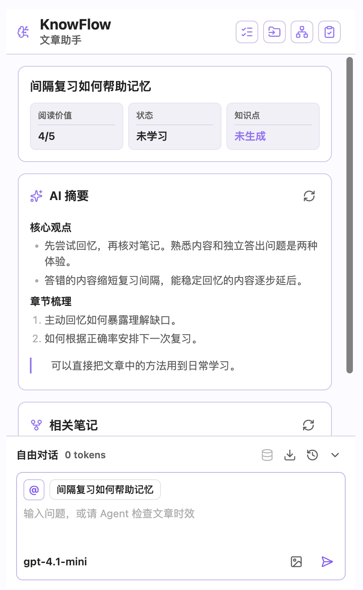
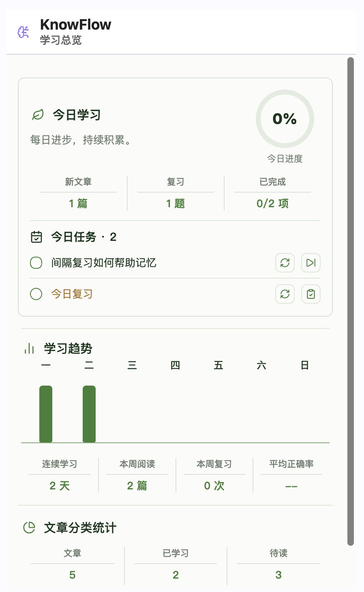

# KnowFlow

中文 | [English](README.en.md)

> Turn notes into knowledge.

KnowFlow is an Obsidian plugin for studying web clippings and Markdown notes. Use your configured AI model to organize clippings, summarize articles, and generate practice quizzes. Track your progress and revisit saved questions in daily reviews.

KnowFlow 是一款 AI 驱动的 Obsidian 学习助手，用于把 Vault 中的网页剪藏和文章转化为可整理、可学习、可测试、可复习的知识资产。

它关注的不是单次摘要，而是一条完整的学习闭环：

```text
Clipping → 整理 → 总结 → 知识点 → Quiz → 学习状态 → 每日复习
```

## 界面截图

| 文章学习 | 学习总览 |
| --- | --- |
|  |  |

## 当前状态

KnowFlow 需要 Obsidian 1.11.5 或更高版本。安装文件见 [GitHub Releases](https://github.com/phoenine/obsidian-knowflow/releases)。

已实现：

- 整理当前 Markdown 剪藏并修复常见格式问题。
- 补全 Frontmatter、识别代码块并处理文章分类。
- 整理时按段落判断：整段中文跳过，整段非中文译成简体中文。代码、公式、独立链接、元信息和已有生成内容不参与。
- 生成 AI 摘要、阅读价值和文章分类建议。
- 生成带原文证据的分组知识点。
- 生成、保存和作答 Markdown Quiz。
- 记录文章学习状态并展示 Task Overview。
- 从全局 Quiz 题库生成每日复习试卷。
- 基于当前文章上下文进行 Chat，并可主动保存会话。回答先依据笔记，必要时补上标明为补充的判断；例子和类比只在有助于理解时出现。笔记缺少会变化的专业事实时，才检索公开资料。默认仅显示底部「与文章对话」，点开后即可输入。收起时会保留草稿和会话，底栏会提示进行中的回复是否完成。
- 使用独立 embedding 模型发现 Relevant Notes，并为 Chat 提供可开关的 Vault Search。
- 整理、摘要、翻译、知识点、Quiz 和时效检查通过具名 Skill 执行。文章问答使用插件内的对话提示词。
- 主动检索公开资料，核对并更新文章中的时效事实。
- 通过标题术语和语义索引筛选相关文章。

暂未开放：

- Auto organize
- Auto generate summary
- Auto generate quiz

前三个自动化还没放进设置，计划在 2.0 后续版本开放。界面语言在 Settings → Basic 切换，默认简体中文。模型回复和笔记字段不随界面语言改变。

## 核心能力

### Clipping Pipeline

KnowFlow 可以处理当前打开的 Markdown 剪藏，并尽量以小范围修改保留原文结构：

- 清理网页剪藏中的广告、页脚和复制水印。
- 修复标题层级、伪标题、列表、表格、引用和代码围栏。
- 识别「提示词」「提示词节选」等标签，用反引号 `text` 围栏保留可复制提示词，并报告处理数量。提示词位置的旧文本围栏会转换为统一格式。
- 写入前检查 YAML、围栏、提示词覆盖及媒体目标是否保留。已有的表格和本地媒体疑点随结果提示。
- 保护已有的 wikilink、embed、callout，以及代码、数学和注释围栏。
- 根据文章模板补全 Frontmatter。
- 将 AI 生成内容排除在后续 AI 输入之外，减少重复 token 和旧结果锚定。
- 点整理直接写回。移动到内置分类时，对应目录不存在会自动创建。

### AI 学习材料

对一篇有学习价值的文章，可以继续生成：

- AI Summary
- 阅读价值与分类建议
- 分组知识点及原文证据
- 单选 Quiz 与答案解析

生成的 Quiz 以 Markdown 文件保存在 `Archives/`，而不是持续写入不断膨胀的插件数据文件。知识点和 Quiz 会保留到原文的索引关系。

### 文章维护

`clipping-update` 的交付是整篇笔记的阅读体验。网页剪藏进入 Obsidian 后，标题、段落、列表、对比结构和可复制示例可能被压缩或变形。插件恢复这些内容的阅读结构，保留原意，让读者能浏览、比较和复制。整理后的正文可直接作为 AI Summary 的输入。

- **内置 Skills**。规则存于项目的 [skills 目录](skills/README.md)，构建时随插件打包。整理时插件先处理能确定的结构，再让模型结合整篇正文判断标题层级。需要确认的代码候选单独分批发送，每批最多 4 条。插件负责校验和写入。Vault 里的 `skills/<名称>/SKILL.md` 会替换同名内置规则。`clipping-update` 会把 Vault 规则或旧的 `clipping-repair` 接在内置规则后面。
- **生成文章摘要**。短文使用清理后的全文，长文在本地按章抽取片段。卡片流式展示文章的核心观点，按需梳理值得单独理解的机制、方法或证据。流式请求在收到内容前失败，或没有返回可用摘要时，用相同输入补发一次普通请求。保存时保留生成期间的正文编辑。
- **对话修改文章**。在当前文章的对话里说明要改的地方，例如「把开头那段改短」。对话先列出插入、替换或删除，回复「更新」或点按钮后才写入。可以只应用其中几条，剩下的会重新编号。对不上原文、原文出现多次、修改互相重叠，或插入位置的段落已经变化时，跳过对应条目。普通提问只留在对话里。
- **文章知识检查**。打开文章后，在 KnowFlow 对话中输入「检查当前文章是否过时」。Chat model 按章节阅读全文，先依据自身知识判断。能判断的说法给出可确认的更新；拿不准的只列出来。在 `Settings → AI Models` 打开 DeepSeek Search 后，这些更新仍然保留，并额外检索拿不准的说法。报告列出可以更新的条目，并询问是否更新原文。建议默认全选。取消勾选不需要的条目，再点「更新」写入选中的建议。增加的内容用 `> [!note]` 标出。点「不用」则保持原文。「检查并更新」同样先列出建议，确认后才写入。聊天里直接改正文不经过这项检索。DeepSeek Search 可复用已配置的官方 API Key，也可设置独立密钥。搜索及必要的网页抓取按接口请求计费。
- **相关文章**。Relevant Notes 先过滤弱语义匹配，再合并具体标题术语的匹配结果，最多展示五篇。共同标签只参与排序。每篇显示可点击的标题、加入 Chat 按钮和最多两行的「简要描述」。

### Task Overview

Task Overview 汇总当天的学习进度：

- 选择当天的新文章任务。
- 默认最多展示 4 项，其余任务折叠。
- 展示全局“今日复习”入口。
- 汇总本周学习与复习趋势。
- 展示 Articles 分类统计，默认显示 4 个分类，其余折叠。

新文章任务跟随当前 Task Overview 范围；每日复习题库始终是全局范围，不受当前文章分类限制。

### 每日复习策略

只有已经学习且存在有效 Quiz 的文章才进入复习题库。

- 新学文章从第二天开始进入题库。
- 选题优先级为：错题 → 未做题 → 到期的正确题。
- 正确题冷却 7 天。
- 每日最多 10 题，可在 Settings → Basic 的 Learning 中调整上限。
- 实际题量根据当前有效题库动态计算，不会用未到期题目强行补足。
- 同一文章默认有 2 题的软上限；题目优先级高于文章分散度。
- 开始答题后锁定当天试卷，刷新不会替换已经开始的题目。
- 答案安全回写原 Quiz；解析可跳转到原文，有章节信息时优先定位章节。

## 推荐 Vault 结构

默认配置兼容以下目录：

```text
Vault/
├── Clippings/                 # Obsidian Web Clipper 的新文章入口
├── Articles/                  # 长期文章库，可按分类建立子目录
├── Archives/                  # 每篇文章对应的 Markdown Quiz
├── copilot-conversations/     # 主动保存的 Chat 会话
└── Template/
    └── article.md              # Frontmatter 字段参考模板
```

所有路径均可在 KnowFlow Settings 的 Basic 标签页中配置。

## AI 模型配置

摘要单独配置。知识点、整理和 Quiz 共用 Task model。Chat 与时效检查共用 Chat model。Embedding model 单独配置。设置项名称是 Task model。支持：

- OpenAI-compatible Cloud API
- Ollama
- LM Studio
- Disabled

每个模型可以独立设置 Runtime、Base URL、API Key 和 Model ID。

Relevant Notes 与 Vault Search 共用本地语义索引。先在 `AI Models` 配置 Embedding model，再到 `Data` 设置 `Excluded folders` 并建立索引；索引只覆盖 `Articles folder` 所配置的文章目录（默认 `Articles/`），默认排除任意层级的 `assets` 子目录。索引使用小型清单和 128 个稳定哈希分片，chunk 元数据与 Float32 二进制向量分开保存，并支持分片级中断续建和损坏隔离。每篇文章只索引已存在的 AI 摘要，无摘要的文章不生成向量。Vault Search 在命中后读取原文段落。已有全文索引在升级后需重建。使用 Cloud runtime 建索引时，AI 摘要会发送给所配置的 embedding 服务。详细设计见 [Relevant Notes 与 Vault Search](docs/relevant-notes-and-vault-search.md)。

### 联网、数据与费用

- **模型服务**。整理、翻译、摘要、知识点和 Quiz 生成会按功能将文章正文或相关片段发送到你配置的模型端点。Chat 会发送问题、对话历史、当前文章和附加的笔记上下文；启用 Vault Search 时，命中的笔记段落也会随请求发送。云端模型使用所选供应商的 API，Ollama 和 LM Studio 默认连接本机。
- **语义搜索**。构建和更新索引时，文章的 AI 摘要会发送到配置的 Embedding 端点。使用 Vault Search 时，搜索内容也会发送到该端点。向量索引保存在 Vault 内。
- **公开搜索与图片修复**。配置可用的 DeepSeek Search Key 后，文章时效检查和需要公开资料的 Chat 会把搜索词发送给 DeepSeek Search，必要时还会提交结果页 URL 以获取网页内容。整理需要检查或恢复图片时，KnowFlow 会直接访问剪藏原网页和相关图片地址。
- **账号与费用**。KnowFlow 免费使用，无需 KnowFlow 账号。云端模型和 DeepSeek Search 需要相应供应商的 API Key，供应商可能要求开通账号并按用量计费。本机模型通常无需 API Key。

### 从 1.0.0 升级

首次加载会把已配置的模型 API Key 迁移到当前 Vault 的 Obsidian 密钥库，并清除插件设置文件中的相应明文。换设备后请在新设备的 KnowFlow 设置中补填缺失的密钥。

如果为“打开侧边栏”或“刷新侧边栏”绑定过快捷键，请在 Obsidian 的快捷键设置中重新绑定。通过命令 ID 调用它们的自动化请改用 `knowflow:open-sidebar` 和 `knowflow:refresh-sidebar`。

## 使用方式

安装并启用插件后，可以：

1. 点击左侧 Ribbon 的脑形图标打开 KnowFlow。
2. 在命令面板运行 `KnowFlow: Open sidebar`。
3. 打开 `Clippings/` 或 `Articles/` 中的 Markdown 文件。
4. 在侧边栏完成整理、摘要、知识点、Quiz 和学习操作。
5. 打开 Articles 根目录或分类目录，查看 Task Overview 和今日复习。

插件还注册了以下命令：

- `KnowFlow: Open sidebar`
- `KnowFlow: Process current clipping`
- `KnowFlow: Refresh sidebar`

## 本地安装

### 手动安装

1. 运行构建：

   ```bash
   npm install
   npm run build
   ```

2. 在 Vault 中创建插件目录：

   ```text
   <Vault>/.obsidian/plugins/knowflow/
   ```

3. 将以下文件复制到插件目录：

   ```text
   main.js
   manifest.json
   styles.css
   ```

4. 在 Obsidian 的 Community Plugins 中启用 KnowFlow。

### 开发安装

仓库提供了开发安装脚本：

```bash
KNOWFLOW_VAULT=/absolute/path/to/vault npm run install:dev
```

安装脚本会构建插件，并只复制 `main.js`、`manifest.json` 和安全的 `styles.css`。如果目标 Vault 中 KnowFlow 已启用，脚本默认拒绝覆盖；确认要覆盖正在启用的开发插件时可以显式执行：

```bash
KNOWFLOW_ALLOW_ENABLED_INSTALL=1 \
KNOWFLOW_VAULT=/absolute/path/to/vault \
npm run install:dev
```

脚本不会自动修改 `community-plugins.json` 来启用插件。

## 开发

环境要求：

- Node.js 20+
- npm
- Obsidian 1.7+

常用命令：

```bash
npm run dev        # 监听源码并构建
npm run typecheck  # TypeScript 类型检查
npm run build      # 生产构建
npm test           # 完整回归测试
```

## 发布

GitHub Actions 包含两条发布相关工作流：

- `CI`：在 main 和 Pull Request 上执行版本校验、完整测试和生产构建，并上传 `knowflow-ci.zip`。
- `Release`：在推送语义版本 tag 后重新验证和构建，创建或更新 GitHub Release，并上传可安装 ZIP 及 Obsidian 标准插件文件。也可以手动运行该工作流，为已存在的 Release 补传产物。

发布前应确保 `package.json`、`package-lock.json`、`manifest.json` 和 `versions.json` 使用同一版本。可以在本地运行：

```bash
npm run release:check
npm test
```

以 `1.1.0` 为例：

```bash
git tag 1.1.0
git push origin main
git push origin 1.1.0
```

Release 将包含：

```text
knowflow-1.1.0.zip
main.js
manifest.json
styles.css
```

Tag 必须与 `manifest.json` 的版本完全一致，例如 `1.1.0`。

## 源码结构

```text
src/
├── main.ts                 # 插件生命周期、命令和服务装配
├── settings.ts             # Settings 页面与默认配置
├── types.ts                # 共享领域类型
├── services/
│   ├── ai/                 # Transport、Prompt builder 和结果解析
│   ├── chat/               # Chat 上下文、流式响应与会话笔记
│   ├── clipping/           # Markdown 整理、翻译与 Pipeline
│   ├── core/               # Store、路径和写入协调边界
│   └── learning/           # Summary、Quiz、知识点与每日复习
└── ui/
    ├── controllers/        # Summary、Quiz、Chat 控制器
    └── *.ts                # Sidebar 和各业务视图
```

纯 Markdown 变换和选题算法尽量与 Obsidian API 解耦，以便通过 Node 测试直接验证；对笔记的实际写入由 service 和 operation coordinator 统一协调。

## 数据与兼容性

- 插件设置和学习状态保存在插件 `data.json`。
- Quiz 保存在 `Archives/*_Quiz.md`，并兼容已有的 managed quiz block。
- 支持旧版分组题号结构，例如 `## 1. 选择题` / `### 1.1. ...`。
- 支持 Quiz Frontmatter 中的相对原文链接，例如 `[[../Articles/...]]`。
- 文件或文件夹重命名时，插件会迁移已记录的文章、Quiz 和每日复习路径。

## 路线图

- 开放 Pipeline 自动整理、自动摘要和自动生成 Quiz。
- 继续完善运行中 Obsidian 的交互和导航验证。

更完整的产品背景与设计边界参见 [产品需求说明](docs/product-requirements.md)。

## License

[MIT](LICENSE)
